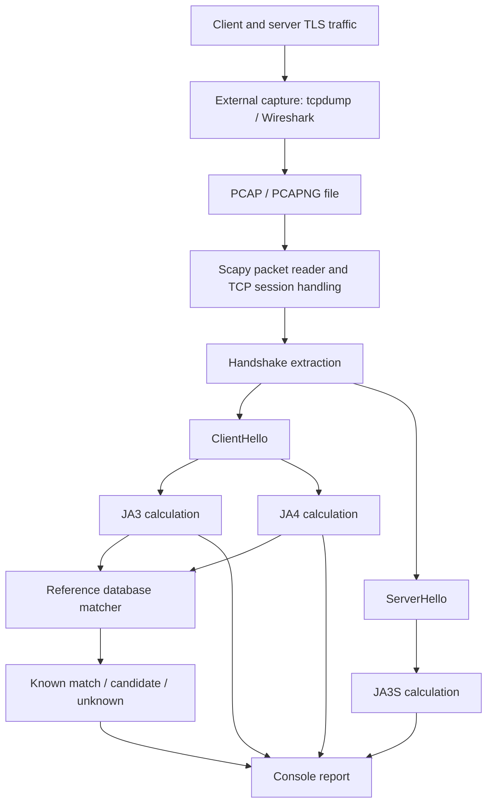

# Architecture and Design

## 1. System overview

The prototype uses an offline, capture-driven pipeline. A packet capture tool records traffic to a PCAP/PCAPNG file. The Python analyzer reads that file, extracts TLS handshake messages, computes fingerprints, and checks client fingerprints against the local JSON database.

## 2. Components

### 2.1 Packet capture

`tcpdump` or Wireshark records packets into a capture file. Capture is separate from the Python fingerprinting program. This separation makes it possible to analyze the same capture repeatedly and compare algorithm changes against identical input traffic.

### 2.2 Packet reader and handshake extraction

Scapy is used to read packet data and inspect TLS layers. TCP session handling/reassembly is important because a TLS handshake message can span multiple TCP segments. The analyzer must reconstruct the message before reading its handshake fields.

### 2.3 Fingerprint calculators

- `src/ja3.py` derives the JA3 client fingerprint from ClientHello fields.
- `src/ja4.py` derives the JA4 client fingerprint from ClientHello characteristics.
- `src/ja3s.py` derives the JA3S server fingerprint from ServerHello fields.

### 2.4 Reference database

`data/fingerprints.json` stores known reference fingerprint records and associated software metadata. The database is intentionally kept separate from experimental observations. A PCAP generated during an experiment must not be added as a known reference merely because it is being tested.

### 2.5 Identification and output

`src/identify.py` processes a capture, prints each ClientHello's addresses and fingerprints, looks for database matches, and summarizes known and unknown results. When a fingerprint maps to more than one record, it reports the candidates rather than asserting a unique identity.

### 2.6 Demonstration runner

`test/run_wire_demo.py` invokes `identify.py` against the selected experimental PCAP files, labels each test, and prints a final execution summary. A completed script execution means the analyzer ran; it does not mean every fingerprint was recognized.

## 3. Design decisions and trade-offs

| Decision | Reason | Trade-off |
|---|---|---|
| PCAP-driven offline analysis | Repeatable experiments and straightforward debugging | Not a continuous live monitor |
| Scapy | Python packet and TLS dissection support | Reassembly and unusual captures require careful handling |
| JSON reference database | Simple, portable, easy to inspect and curate | Not designed for high-volume concurrent updates |
| JA3 and JA4 together | Compare traditional ordered fingerprinting with JA4's normalization choices | More implementation and database-maintenance work |
| Console output | Simple demonstration and debugging | No dashboard, alerting, or long-term analytics |

## 4. Data flow

1. Capture TLS traffic and save a PCAP/PCAPNG file.
2. Read packets and reconstruct the relevant TCP/TLS handshake data.
3. Extract ClientHello messages for JA3 and JA4 processing.
4. Extract ServerHello messages for JA3S processing.
5. Compare calculated client fingerprints with reference records.
6. Print the observed values, matching candidate metadata, and per-capture summary.

The project does not currently use eBPF/XDP, TRex, Redis, or Valkey. Those technologies are not required by the implemented offline prototype.
